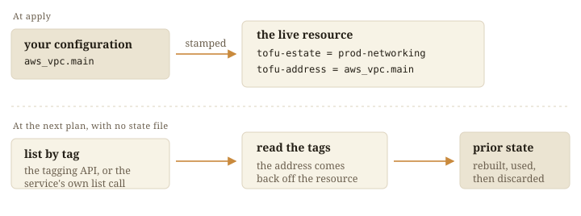

A marker is the owner written on the resource. The apply writes it on the
create call, so a resource that exists carries one.

| Platform | Where identity lives |
|---|---|
| AWS | Two tags, `tofu-estate` and `tofu-address`, plus `tofu-slot` on a `count` set whose members are interchangeable |
| Kubernetes | One label, `tofu-estate`, with the address in an annotation |

Any tool that can write the marker can adopt a resource, and any tool that can
read it can list an estate.

## Two ways back

Where your configuration names the resource, an S3 bucket or an IAM role, the
marker confirms ownership. Where the platform assigns the id, a VPC or a
subnet, the marker is the only way back, so a name has to be computable before
the resource exists.

## Types with no tags

About half the AWS provider's resource types have no `tags` argument. An
`aws_iam_role_policy` is a role name and a policy name, both from
configuration, so it is found again on every run. A missing tag does limit
access control: an IAM condition on the tag has nothing to match.

## Renaming and stripping

`choudoufu live-mv` rewrites the marker ([rename a
resource](../../docs/use/rename-a-resource/)). A stripped marker makes the
resource invisible to the next plan, which proposes a second one.
[`live/IDENTITY.md`](https://github.com/INTENTIUS/choudoufu/blob/main/live/IDENTITY.md)
has the full rule.
