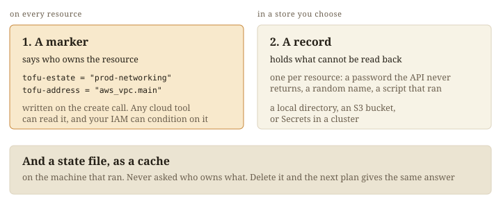
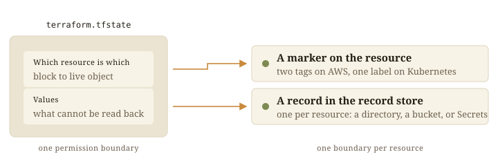

OpenTofu keeps a state file: which real resource each block created, plus the
values it cannot read back. Whoever can write that file can change anything in
it, and losing it loses track of what you own.

choudoufu is OpenTofu with a different backend, the live backend. Ownership
goes on the resources and the rest goes in small records, so no single file
needs guarding.



## Four words

An estate is one configuration and everything it owns. You name it once, in
`estate.chdf.hcl`, and the name is the unit of ownership and of access control.

A marker is the estate's name written on a resource, with the address of the
block that declares it. On AWS it is two tags, `tofu-estate` and
`tofu-address`; on Kubernetes it is one label. The apply writes it on the
create call. [Identity](identity/) has the rules.

A record holds what cannot be read back from the live resource: a password the
API never returns, a random name, the fact that a script ran. There is one per
resource, in the record store. [Records](values/) has the kinds and stores.

## The marker says what you own

A plan finds your resources by their markers and reads each one live. Any cloud tool can list an estate, and your own IAM
or RBAC decides who may change which resource.

```
aws resourcegroupstaggingapi get-resources \
  --tag-filters Key=tofu-estate,Values=prod-networking
```

## The state file becomes a cache

Every run still writes an ordinary state file on the machine that ran it. It is
never asked who owns what, and deleting it changes no plan. Remove the `live`
block, keep that file, and stock OpenTofu carries on with it.
[The cache](cache/) says what it buys.

## What changes from a state file



| | `terraform.tfstate` | choudoufu |
|---|---|---|
| Permission unit | one file | one resource |
| To narrow access | split the state | write a policy |
| Two applies at once | a lock a crash can orphan | a conditional write per record |
| Losing it | you no longer know what you own | a slower plan |

## What it costs

A plan reads the live system and not a file, so it does more work;
[`live/PLAN-CONE.md`](https://github.com/INTENTIUS/choudoufu/blob/main/live/PLAN-CONE.md)
has the numbers. A marker has to be knowable before the resource exists, which
limits what a configuration may compute in a name.
[Compatibility](../aws/compatibility/) lists what that rules out.

## Upstream

choudoufu forks [opentofu/opentofu](https://github.com/opentofu/opentofu),
tracks it, and is licensed MPL-2.0 like OpenTofu. It is not affiliated with
OpenTofu or the Linux Foundation, which owns the OpenTofu trademark.
