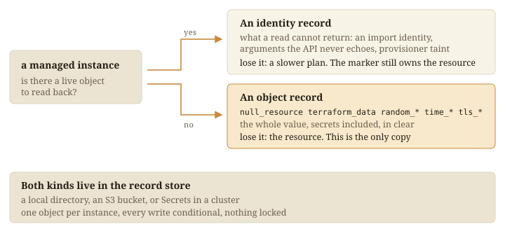

Ownership lives on the resource. Everything else a run must remember lives in
the record store, one record per managed instance.



## Two kinds

| Kind | For | Losing it costs |
|---|---|---|
| `identity` | A resource with a live object. Holds what a read cannot return | A slower plan |
| `object` | A record-backed resource with no live object: `null_resource`, `random_*`, `time_*`, `tls_*`. Holds the whole value | The resource |

A lost `object` record can cost more than itself. If names are built from a
`random_pet`, losing its record renames everything built on it.
[Recover an estate](../../docs/use/recover-an-estate/) has the procedure.

## Three stores

| Store | Records are | For |
|---|---|---|
| `local` | Files in `.tofu-records` | One operator. The default |
| `s3` | Objects in your bucket | A team on AWS |
| `kubernetes` | Secrets in your namespace | A team on a cluster |

```hcl
record_store "s3" {
  bucket = "my-records-bucket"
}
```

All three give the same guarantees. Every write is conditional on nobody having
changed the record since it was read, and nothing is locked, so a crashed run
leaves nothing held. Each record carries its estate's tag or label, so one
bucket serves many estates under your own IAM or RBAC.

## It holds secrets

The store holds what a state file would. By default a generated password is
recorded in clear, so decide who may read the store first.
[`live/SECRETS.md`](https://github.com/INTENTIUS/choudoufu/blob/main/live/SECRETS.md)
has `secrets = "refuse"`, and
[`live/STORAGE.md`](https://github.com/INTENTIUS/choudoufu/blob/main/live/STORAGE.md)
each store's layout.
