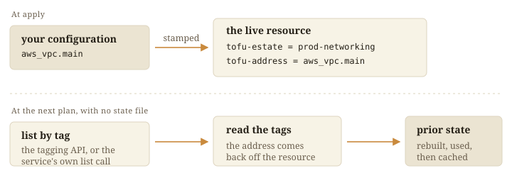

A marker names the estate that owns a resource. The create call writes it.

| Platform | Where identity lives |
|---|---|
| AWS | Tags `tofu-estate` and `tofu-address`, plus `tofu-slot` on pool members |
| Kubernetes | The `tofu-estate` label, with the address in an annotation |

On Kubernetes a plan finds each kind by the label and joins each object to its
block on namespace and name.

## Two ways back

Where configuration names the resource, such as an S3 bucket, the marker
confirms ownership. Where the platform assigns the id, such as a VPC, the
marker finds it.

## Types with no tags

An AWS type with no `tags` argument takes its identity from configuration, as
`aws_iam_role_policy` does.

## Who may change it

| Platform | The fence |
|---|---|
| AWS | IAM conditions on the `tofu-estate` tag ([gate](../../aws/gate/)) |
| Kubernetes | One admission policy on the label ([gate](../../kubernetes/gate/)) |

Both bind the credential, so a plain `aws` or `kubectl` call meets the same
fence.

## Renaming

`choudoufu live-mv` rewrites the marker ([rename a
resource](../../docs/use/rename-a-resource/),
[`live/IDENTITY.md`](https://github.com/INTENTIUS/choudoufu/blob/main/live/IDENTITY.md)).
