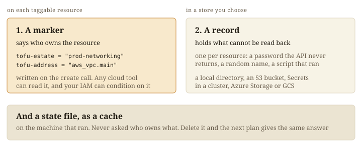
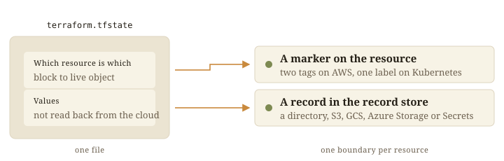

choudoufu is OpenTofu with ownership on the resources. Each taggable resource
carries its estate's marker, and small records hold the rest.



## Three words

An estate is one configuration and everything it owns, named once in
`estate.chdf.hcl`, the live backend.

A marker is a tag or label holding the estate name. The block address sits
beside it: a tag, a label, or on Kubernetes the
`choudoufu.intentius.io/tofu-address` annotation ([Identity](identity/)).

A record holds what a read of the live resource leaves out, such as a
generated password ([Records](values/)).

## The marker says what you own

A plan finds resources by marker and reads each one live. Any tool can list an
estate:

```
aws resourcegroupstaggingapi get-resources \
  --tag-filters Key=tofu-estate,Values=prod-networking

kubectl get configmaps,services -A -l tofu-estate=prod-networking
```

## Stock backends and the live backend



| | Stock backend | choudoufu live backend |
|---|---|---|
| Permission unit | one file | one resource |
| To narrow access | split the state | write a policy |
| Two applies at once | a lock on the whole state | [no lock, a conditional write per record](locking/) |
| Losing the state file | you lose what you own | a slower plan, since it is a [cache](cache/) |

## Two runs, and many roots

[Resource-level concurrency](locking/) covers two applies to one estate.
[One plan, one apply, across roots](across-estates/) covers one run over
several roots, with Terragrunt, Atmos or a composed root.

## Upstream

choudoufu forks and tracks [opentofu/opentofu](https://github.com/opentofu/opentofu)
under MPL-2.0. It is not affiliated with OpenTofu or the Linux Foundation,
owner of the OpenTofu trademark.
