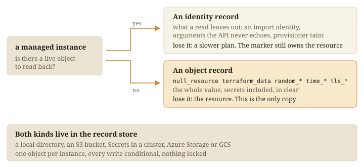

Each managed instance has one record. It holds what a run must remember beyond
ownership.



## Two kinds

| Kind | For |
|---|---|
| `identity` | A resource with a live object: what a read cannot return |
| `object` | A resource with no live object, such as `random_*` or `tls_*`: the whole value |

## Four stores

| Store | Records are | For |
|---|---|---|
| `local` | Files in `.tofu-records` | One operator (default) |
| `s3` | Objects in your bucket | A team on AWS |
| `kubernetes` | Secrets in your namespace | A team on a cluster |
| `azurerm` | Blobs in your Storage container | A team on Azure |

```hcl
record_store "s3" {
  bucket = "my-records-bucket"
}
```

Each write is conditional on the record being unchanged since it was read. One
bucket serves many estates.

## It holds secrets

The store holds generated passwords, so guard it as you guard a state file
([`live/SECRETS.md`](https://github.com/INTENTIUS/choudoufu/blob/main/live/SECRETS.md)).
